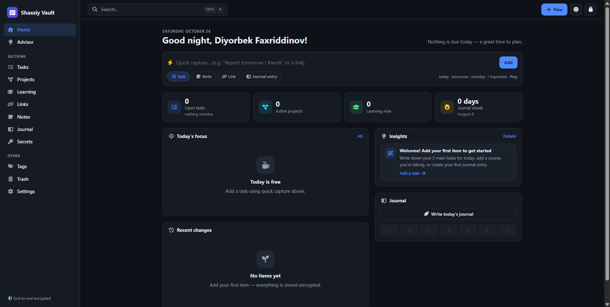
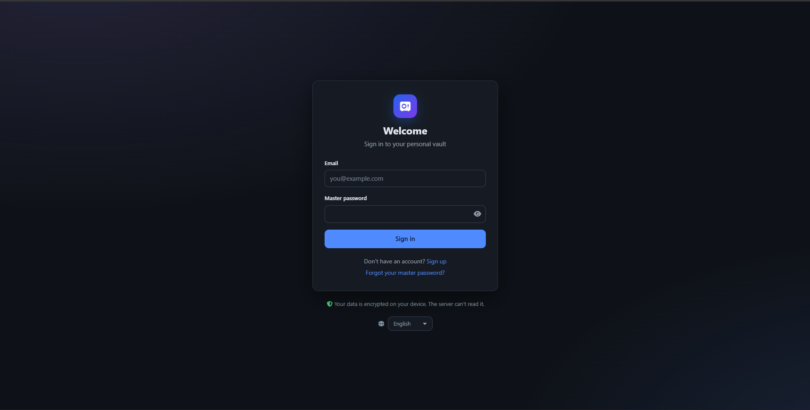
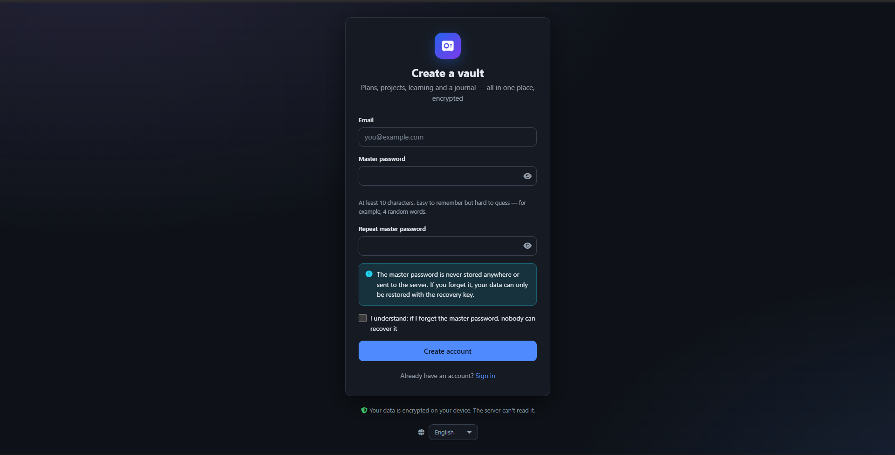
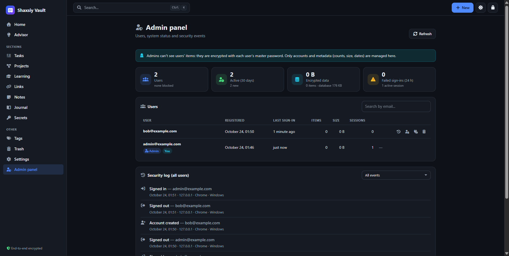

# Shaxsiy Vault

[English](README.md) · **O'zbekcha**

Rejalar, loyihalar, havolalar, o'qish rejalari, kundalik va maxfiy ma'lumotlar uchun **uchdan-uchgacha shifrlangan** shaxsiy ombor. Hammasi bir joyda saqlanadi, tez topiladi va maslahat beradi.

Server va MySQL faqat shifrlangan bloklarni ko'radi. Master parol ham, ma'lumotlarni ochadigan kalit ham brauzerdan tashqariga chiqmaydi.

Interfeys uch tilda: **o'zbekcha**, **inglizcha** va **ruscha**.

---

## Skrinshotlar



| Kirish | Ro'yxatdan o'tish | Admin panel |
|---|---|---|
|  |  |  |

---

## Imkoniyatlar

| Bo'lim | Nimalar bor |
|---|---|
| **Bosh sahifa** | Bugungi fokus, yaqin 7 kun, statistika, maslahatlar, faol loyihalar va o'qish progressi, haftalik kayfiyat |
| **Tezkor yozish** | Bir qatordan yozuv yaratadi: `Hisobot ertaga ! #ish` → vazifa (muddat ertaga, muhim, teg). URL yozilsa → havola. `bugun`, `ertaga`, `indinga`, hafta kunlari, `!` / `!!`, `#teg`, `fikr:` / `kundalik:` prefikslari. Kalit so'zlar inglizcha va ruscha ham tushuniladi (`tomorrow`, `завтра`, `monday`, `понедельник`, `note:`, `задача:` ...) |
| **Vazifalar** | Holat, muhimlik, muddat, takrorlanish (kunlik/haftalik/oylik), kichik vazifalar, loyihaga bog'lash; "Kechikkan / Bugun / Ertaga / Shu hafta" guruhlari |
| **Loyihalar** | Maqsad, muddat, havola; progress bog'langan vazifalardan avtomatik hisoblanadi |
| **O'qish va o'rganish** | Kurs/kitob/video/mavzu, bosqichlar, sarflangan vaqt (+30 daq), maqsadli sana, konspekt |
| **Havolalar** | To'plamlar, o'qilgan/o'qilmagan, tavsif |
| **Eslatmalar** | Markdown muharriri (asboblar paneli, ko'rish rejimi, Ctrl+B/I) |
| **Kundalik** | Kayfiyat, minnatdorlik, ketma-ketlik (streak), 20 haftalik issiqlik xaritasi |
| **Maxfiy ma'lumotlar** | Login/parol, parol generatori, kuch bahosi, nusxa olish |
| **Maslahatchi** | Qoidalarga asoslangan maslahatlar (kechikkan ishlar, harakatsiz loyihalar, zaif/takror parollar, zaxira eslatmasi...) — **to'liq brauzerda**. Ixtiyoriy **AI maslahatchi** (Claude) — faqat rozilik bilan |
| **Qidiruv** | `Ctrl+K` buyruqlar oynasi, `#teg` filtri, o'zbekcha apostroflarga chidamli (`o'qish` = `oqish`) |
| **Teglar** | Barcha bo'limlarni bog'laydi; qayta nomlash, birlashtirish, o'chirish |
| **Savat** | O'chirilganlarni tiklash yoki butunlay o'chirish, "Qaytarish" (undo) |
| **Til** | O'zbekcha, English, Русский. Kirish ekranida va Sozlamalar → Ko'rinish bo'limida tanlanadi; sahifa darhol yangi tilda qayta chiziladi (vault qulflanmaydi). Birinchi ochilishda brauzer tiliga qarab aniqlanadi. Server xato xabarlari ham tanlangan tilda keladi |
| **Sozlamalar** | Til, mavzu, avtomatik qulflash, master parolni almashtirish, tiklash kalitini yangilash, faol sessiyalar, xavfsizlik jurnali, zaxira nusxa (shifrlangan / JSON / Markdown) va import, hisobni o'chirish |

**Klaviatura:** `Ctrl+K` qidiruv · `Ctrl+Shift+L` qulflash · `Ctrl+S` saqlash · `Esc` bekor qilish · `E` tahrirlash · ro'yxatda `/` qidiruv, `N` yangi yozuv.

---

## O'rnatish (Windows + MySQL 8)

Talablar: **Node.js 20.12+**, **MySQL 8** (ishlab turgan bo'lsin).

```powershell
npm install          # kutubxonalar
npm run init         # .env yaratadi (APP_SECRET va ilova uchun DB parolini avtomatik yaratadi)
```

`.env` faylini oching va **`DB_ADMIN_PASSWORD`** ga MySQL `root` parolingizni yozing. So'ng:

```powershell
npm run db:setup     # "shaxsiy_vault" bazasini va cheklangan huquqli "vault_app" foydalanuvchisini yaratadi
npm start            # http://127.0.0.1:3000
```

> `db:setup` dan keyin `.env` dagi `DB_ADMIN_USER` / `DB_ADMIN_PASSWORD` qatorlarini o'chirib tashlash tavsiya etiladi — ilova ularsiz ishlaydi.

Ishlab chiqish rejimi (kod o'zgarsa server qayta ishga tushadi): `npm run dev`.

### Admin panel

1. `.env` da admin email(lar)ini yozing: `ADMIN_EMAILS=siz@example.com` (bir nechtasi bo'lsa vergul bilan).
2. Serverni qayta ishga tushiring va ilovada **shu email bilan** ro'yxatdan o'ting (yoki kiring).
3. Yon menyuda **Admin panel** paydo bo'ladi (`/admin`).

Admin panelda:
- **Statistika:** foydalanuvchilar, faollik, shifrlangan ma'lumot va baza hajmi, xato kirishlar.
- **Foydalanuvchilar:** qidiruv; har bir foydalanuvchining yozuvlar soni, hajmi va sessiyalari.
- **Hisobni boshqarish:**
  - bloklash (barcha qurilmalardan chiqariladi, qayta kira olmaydi) va blokdan chiqarish;
  - barcha qurilmalardan chiqarish;
  - o'chirish (email qayta yozib tasdiqlanadi).
- **Xavfsizlik jurnali:** barcha foydalanuvchilar bo'yicha; hodisa turi va foydalanuvchi bo'yicha filtr.

> Admin ham foydalanuvchilarning **yozuvlarini o'qiy olmaydi** — ular har bir foydalanuvchining master paroli bilan shifrlangan. Admin o'zini va boshqa adminlarni bloklay/o'chira olmaydi.

### AI maslahatchini yoqish (ixtiyoriy)

1. [platform.claude.com](https://platform.claude.com) dan API kalit oling.
2. `.env` ga yozing: `ANTHROPIC_API_KEY=sk-ant-...`
3. Serverni qayta ishga tushiring, so'ng ilovada **Maslahatchi** sahifasida roziligingizni bering.

Model: `claude-opus-5-5` (`AI_MODEL` orqali o'zgartirish mumkin). Rad etilgan so'rovlar uchun server tomonidagi zaxira model (`fallbacks: "default"`) yoqilgan.

---

## Xavfsizlik modeli

```
 master parol ──PBKDF2-SHA256 (600 000)──▶ master kalit
                                            ├─HKDF "auth"──▶ authKey ──▶ server (faqat scrypt xeshi saqlanadi)
                                            └─HKDF "wrap"──▶ wrapKey ──▶ DEK'ni ochadi (brauzerdan chiqmaydi)

 DEK (tasodifiy 256-bit, xotirada, eksport qilib bo'lmaydi)
   └─AES-256-GCM──▶ har bir yozuv (AAD = yozuv id), sozlamalar

 tiklash kaliti (256-bit, 52 belgi) ──HKDF──▶ DEK'ning ikkinchi shifrlangan nusxasi
```

- **Zero-knowledge:** MySQL'da yozuvning turi, sarlavhasi, matni, teglari — hech narsa ochiq emas. Bu test bilan tekshiriladi.
- **Master parolni unutsangiz** — faqat ro'yxatdan o'tishda berilgan **tiklash kaliti** yordam beradi. Server parolni tiklay olmaydi.
- **Parol almashtirilganda** yozuvlar qayta shifrlanmaydi (DEK o'zgarmaydi, faqat qayta o'raladi), boshqa qurilmalardagi sessiyalar yopiladi.
- **Sessiyalar:** `httpOnly` + `SameSite=Strict` cookie, bazada faqat tokenning SHA-256 xeshi. Sahifa yangilansa yoki faolsizlik vaqti o'tsa — vault qulflanadi (kalit xotiradan o'chadi).
- **Himoya qatlamlari:** qat'iy CSP (inline skript va tashqi CDN yo'q), CSRF sarlavhasi + Origin tekshiruvi, so'rovlar chegarasi (brute-force), Zod validatsiyasi, parametrlashtirilgan SQL, har bir so'rov `user_id` bilan cheklangan, XSS'siz DOM (`h()`), xavfsiz Markdown, `javascript:` havolalar bloklanadi.
- **Email oshkor qilinmaydi:** noma'lum email uchun ham `prelogin` barqaror soxta salt qaytaradi, solishtirish vaqti bir xil.
- **Xavfsizlik jurnali:** kirishlar, muvaffaqiyatsiz urinishlar, parol/tiklash kaliti o'zgarishlari.
- **AI:** faqat rozilik bilan; qaysi bo'limlar yuborilishini o'zingiz tanlaysiz va oldindan ko'rasiz. Parollar hech qachon yuborilmaydi, serverda saqlanmaydi. AI savol berilgan tilda (aniq bo'lmasa — interfeys tilida) javob beradi.
- **Til tanlovi** maxfiy emas: u brauzerning `localStorage`ida (`vault:lang`) saqlanadi, shunda kirish ekrani ham tanlangan tilda ochiladi.

> **Internetga chiqarishda** albatta HTTPS ishlating (`NODE_ENV=production` — cookie `Secure` bo'ladi, HSTS yoqiladi). Nginx ortida bo'lsa `TRUST_PROXY=true`.

---

## Arxitektura

```
server/                         Node.js + Express 5 + MySQL (mysql2)
├── index.js                    ishga tushirish, migratsiyalar, sessiyalarni tozalash, graceful shutdown
├── app.js                      Express ilovasi (testlar ham shuni ishlatadi)
├── config.js                   .env → Zod bilan tekshirilgan konfiguratsiya
├── db/                         pool, tranzaksiyalar, migratsiyalar (migrations/*.sql), setup
├── lib/                        xatolar, kriptografiya, validatsiya, umumiy sxemalar, HTTP yordamchilari, i18n (server xabarlari)
├── middleware/                 sessiya, CSRF, rate-limit, xavfsizlik sarlavhalari, xatolarni qayta ishlash
└── modules/                    har bir modul: routes → controller → service → repository (+ schemas)
    ├── auth/                   ro'yxat, prelogin, kirish/chiqish, tiklash kaliti bilan tiklash
    ├── account/                parol, tiklash kaliti, sozlamalar, sessiyalar, jurnal, hisobni o'chirish
    ├── items/                  shifrlangan yozuvlar: CRUD, versiyalash (optimistik qulf), sinxronlash, import
    ├── ai/                     Claude bilan SSE oqimi
    ├── admin/                  admin panel: statistika, foydalanuvchilarni boshqarish, umumiy jurnal
    ├── sessions/ users/ audit/

public/                         Vanilla JS SPA (ES modullar, build yo'q)
├── js/core/                    crypto (WebCrypto), vault (kalit), store (yozuvlar), api, router, idle, events, i18n (til)
├── js/locales/                 tarjimalar: en.js · uz.js · ru.js
├── js/models/types.js          yozuv turlari reestri — formalar va ro'yxatlar shu yerdan quriladi
├── js/services/                auth oqimlari, sozlamalar, qidiruv, maslahatlar, tahlil, tezkor yozish, zaxira, AI
├── js/ui/                      DOM yordamchilari, maydonlar, kartochka, dialog, toast, markdown, palitra...
├── js/views/                   sahifalar: shell, auth, dashboard, collection, item, tags, trash, advisor, settings
└── css/                        base (tokenlar, mavzular) · layout · components · views

tests/                          node:test — kriptografiya, xizmatlar, tarjimalar, to'liq API integratsiyasi
```

**Yangi yozuv turi qo'shish** — `public/js/models/types.js` ga bitta obyekt (maydonlar, standart qiymatlar, filtrlar) qo'shing; forma, ro'yxat, qidiruv va zaxira avtomatik ishlaydi. Kartochka ko'rinishi uchun `ui/item-card.js` ga renderer qo'shing. Turning nomlari (`types.<tur>.label`, `.plural`, `.new` ...) uchala lug'atga qo'shiladi.

### Tarjimalar (i18n)

- **Frontend:** barcha matnlar `t("kalit")` orqali olinadi (`public/js/core/i18n.js`), lug'atlar — `public/js/locales/{en,uz,ru}.js`. Parametrlar: `t("common.itemsCount", { count: 3 })`. Ko'plik shakllari `Intl.PluralRules` bo'yicha tanlanadi: ingliz tilida `{ one, other }`, rus tilida `{ one, few, many, other }`, o'zbek tilida oddiy satr. Kalit topilmasa — inglizchasi ishlatiladi.
- **Sanalar:** ingliz va rus tillarida `Intl.DateTimeFormat`, o'zbek tilida o'zimizning formatlar (`ui/format.js`).
- **Server:** xatolar kalit bilan yaratiladi (`errors.invalidLogin`), `server/lib/i18n.js` ularni so'rov tiliga o'giradi. Til: `X-Vault-Lang` sarlavhasi (ilova har so'rovda yuboradi) → `Accept-Language` → ingliz tili.
- **Yangi til qo'shish:** `public/js/locales/` ga yangi lug'at, `core/i18n.js` dagi `LANGUAGES` ro'yxatiga yozuv va `server/lib/i18n.js` ga xabarlar qo'shing. `npm test` barcha lug'atlarda kalitlar va `{parametr}`lar bir xilligini tekshiradi.

### API

| Metod | Yo'l | Vazifa |
|---|---|---|
| POST | `/api/auth/prelogin` | KDF salt va iteratsiyalar |
| POST | `/api/auth/register` · `/login` · `/logout` | hisob, kirish, chiqish |
| GET | `/api/auth/me` | joriy hisob + shifrlangan DEK |
| POST | `/api/auth/recovery/challenge` · `/reset` | tiklash kaliti bilan tiklash |
| GET / POST | `/api/items` (`?since=`) | yozuvlar (to'liq yoki qisman sinxronlash) |
| PUT / DELETE | `/api/items/:id` | yangilash (`version` bilan, 409 — to'qnashuv) / o'chirish |
| POST | `/api/items/batch` | import (500 tagacha) |
| PUT | `/api/account/password` · `/recovery` · `/settings` | hisob sozlamalari |
| GET / DELETE | `/api/account/sessions[/:id]` | sessiyalar |
| GET | `/api/account/activity` | xavfsizlik jurnali |
| DELETE | `/api/account` | hisobni o'chirish |
| GET / POST | `/api/ai/status` · `/api/ai/chat` | AI holati / SSE suhbat |
| GET | `/api/admin/stats` · `/api/admin/users` · `/api/admin/audit` | admin: statistika, foydalanuvchilar, jurnal |
| POST / DELETE | `/api/admin/users/:id/disable` · `/enable` · `/sessions` · `/:id` | admin: bloklash, blokdan chiqarish, chiqarish, o'chirish |

O'zgartiruvchi barcha so'rovlarda `X-Vault-Request: 1` sarlavhasi bo'lishi shart. Ixtiyoriy `X-Vault-Lang: en|uz|ru` sarlavhasi xato xabarlari tilini belgilaydi.

---

## Testlar

```powershell
npm test
```

Testlar **alohida** `shaxsiy_vault_test` bazasida ishlaydi va uni har safar noldan yaratadi (asosiy bazaga tegmaydi; nom `_test` bilan tugamasa ishga tushmaydi). Ular quyidagilarni qamrab oladi: shifrlash, AAD bog'lanishi, tiklash kaliti, ro'yxat/kirish, IDOR himoyasi, versiya to'qnashuvi, sinxronlash, import, parol almashtirish, tiklash, sessiyalar, hisobni o'chirish, CSRF, CSP, qidiruv, maslahatlar, tezkor yozish (uch tildagi kalit so'zlar), Markdown XSS, shuningdek tarjimalar: uchala lug'atda kalitlar va parametrlar bir xilligi, koddagi har bir kalit lug'atda borligi, ko'plik shakllari va server xabarlarining tilga qarab qaytishi.

## Cheklovlar

- Fayl (rasm, PDF) biriktirish hozircha yo'q.
- Qidiruv brauzerda ishlaydi (maxfiylik uchun). Bu o'n minglab yozuvgacha tez, undan ko'pida sekinlashishi mumkin.
- Oflayn rejim yo'q: server bilan aloqa kerak.
- Interfeys va API xabarlari uch tilda; server konsoli (loglar) va `npm run init` / `db:setup` skriptlarining chiqishi esa o'zbek tilida.
- Til tanlovi qurilmaga bog'liq (`localStorage`), hisob bilan boshqa qurilmalarga sinxronlanmaydi.

## Litsenziya

[MIT](LICENSE) © 2026 Diyorbek Faxriddinov
